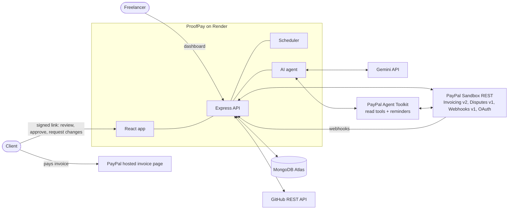
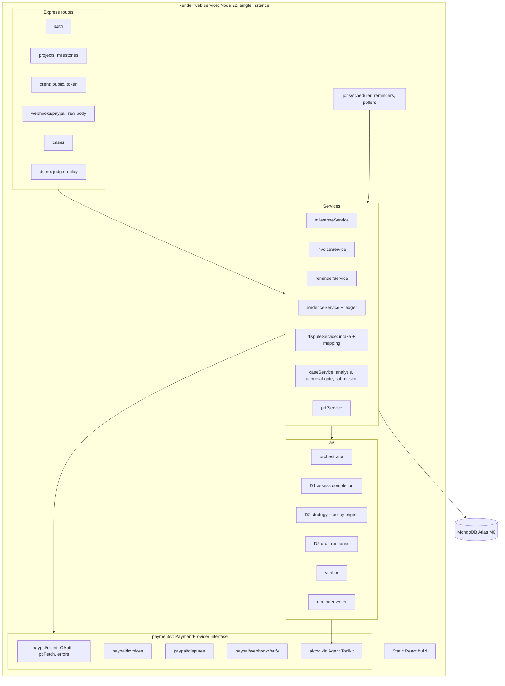
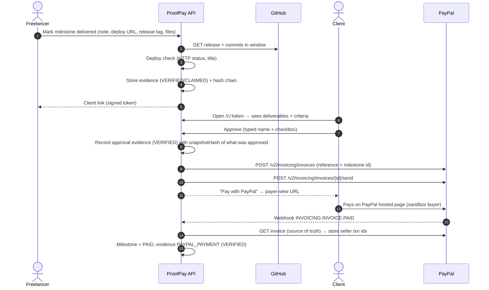
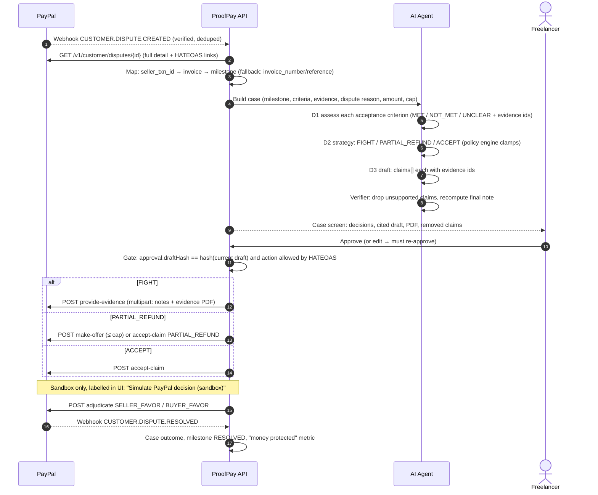
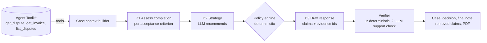

# ProofPay — High-Level Design (HLD)

> **Version** 1.0 · 6 Nov 2026 · Owners: Backend/PayPal/AI (B) + Frontend/Design/Video (F)
> **Read with:** `LLD.md` (exact schemas, endpoints, code), `PRD_AND_BUILD_GUIDE.md` (what to build and in what order), `CLAUDE.md` (project memory).
> Items marked **[DEFAULT]** are decisions taken without team input. Change them in the HLD *and* in `CLAUDE.md` if you disagree.
> Items marked **[VERIFY-D1]** are API behaviours the Day-1 sandbox test must confirm.

---

## 0. Decisions taken as defaults

| # | Decision | Default | Why |
|---|---|---|---|
| D-1 | Lock & Release (authorize/capture) | **Cut**. Mentioned as "next step" in README only | Second payment flow, small demo value, 3-day capture-guarantee edge cases |
| D-2 | Does the client need a PayPal account to approve? | **No.** Approve via signed link. PayPal account (sandbox buyer) only needed to **pay** | Lower friction, and the approval is our evidence, independent of PayPal |
| D-3 | Partial-refund cap | Freelancer sets it **per project**, default **30%** of milestone | A cap the AI can never exceed; set before any dispute |
| D-4 | What counts as **verified** evidence | Captured **server-side** from GitHub API, PayPal API, or a client action on the client page. Everything typed/uploaded by the freelancer is **claimed** | Simple, honest rule we can explain in one sentence |
| D-5 | Deployment shape | **One** Render web service (Express API + built React app + in-process scheduler) + MongoDB Atlas M0 | One URL, no CORS, cheapest to keep alive until 15 Dec |
| D-6 | Render plan | **Starter (paid, from the $50 credit)**, not free | Free tier sleeps → slow webhooks, and judges test until **15 Dec 2026** |
| D-7 | Currency | **USD** only | Freelancers with clients abroad; sandbox accounts default to USD |
| D-8 | AI model | Gemini via Vercel AI SDK **v4**, model name from env `GEMINI_MODEL` (default `gemini-3.5-flash-lite`) | Agent Toolkit 1.11 depends on `ai@^4`; Gemini 2.5 is shut down (Oct 2026) |
| D-9 | Prize focus | Best Use of PayPal + AI (honorable mention) + AG Grid (sponsor) | Max allowed: one grand/HM + one sponsor |
| D-10 | Auth | One pre-made freelancer account (email + password from env), JWT in httpOnly cookie | Out of scope to build sign-up |

---

## 1. What we are building (one paragraph)

ProofPay captures **proof at the moment of delivery** (GitHub release/commits, deploy check, files, and the client's own "Approve" click), sends a **PayPal invoice only after the client approves**, chases unpaid invoices with AI reminders that cite the approval, and when a **PayPal dispute** arrives it maps the dispute back to the milestone, has an AI agent decide *was it done / fight, partially refund or accept / what to say*, strips any claim not backed by evidence, and — **only after the freelancer approves** — submits the response through PayPal's own Disputes API.

---

## 2. System context

---

## 3. Architecture (containers and modules)

### 3.1 Components and responsibilities

| Component | Responsibility | Owner |
|---|---|---|
| **React app** (Vite, Tailwind, AG Grid) | Freelancer dashboard, milestone/evidence views, dispute case screen with approval, client review page, AG Grid dashboard | F |
| **routes/** | HTTP surface, input validation (zod), auth middleware | B |
| **milestoneService** | Milestone lifecycle (draft → delivered → approved → invoiced → paid → disputed → resolved) | B |
| **invoiceService** | Create + send PayPal invoice on approval; store payer link; record payments from webhook | B |
| **reminderService** | Unpaid-invoice reminders written by AI, sent via Agent Toolkit `send_invoice_reminder`; max 3, cooldown | B |
| **evidenceService + ledger** | Pull GitHub release/commits, deploy check, uploads, client actions; tag VERIFIED/CLAIMED; hash-chain every item | B |
| **disputeService** | Ingest dispute webhook, fetch full dispute, map → invoice → milestone → evidence, track lifecycle | B |
| **caseService** | Run AI analysis, hold the human approval gate, submit to PayPal, record outcome | B |
| **pdfService** | Evidence pack PDF (attached to provide-evidence and downloadable) | B |
| **ai/** | Orchestrator + 3 decisions + verifier + reminder writer; Gemini via AI SDK v4 | B |
| **payments/paypal/** | The **only** code that talks to PayPal. Behind a `PaymentProvider` interface so another provider can be added later | B |
| **jobs/scheduler** | node-cron: reminders, polling disputes as a fallback for missed webhooks | B |
| **Design system, video, Devpost text** | Visual identity, screens, 3-min video, thumbnails | F |

---

## 4. Core data (summary — full schemas in LLD §4)

| Collection | Key fields | Notes |
|---|---|---|
| `users` | email, passwordHash, name, settings.partialRefundCapPct, settings.autoReminders | One pre-made freelancer |
| `clients` | name, email | Client's email = PayPal invoice recipient |
| `projects` | ownerId, clientId, title, github {owner, repo}, clientTokenHash, refundCapPct | Client link token stored hashed |
| `milestones` | projectId, title, scope, acceptanceCriteria[], amountCents, status, delivery{}, approval{}, invoiceId | Status machine in LLD §5 |
| `evidence` | milestoneId, kind, trust (VERIFIED/CLAIMED), source, summary, data, file{}, seq, sha256, prevHash | Append-only, hash-chained per project |
| `invoices` | milestoneId, paypalInvoiceId, invoiceNumber, status, payerViewUrl, sellerTxnIds[], reminders[] | `sellerTxnIds` is the primary dispute join key |
| `cases` | paypalDisputeId (unique), milestoneId, mapping{}, status mirror, ai{assessment, strategy, draft, verification}, approval{draftHash}, submissions[], outcome, timeline[] | One case per PayPal dispute |
| `webhookEvents` | eventId (unique), type, verified, processedAt, error | Idempotency + audit |
| `auditLog` | actor, action, entity, at, meta | Every approval / submission / AI run |

---

## 5. Key flows

### F1 — Deliver → Approve → Invoice → Paid

"Request changes" instead of Approve → the change request is stored as evidence (VERIFIED, from the client page), milestone goes back to `CHANGES_REQUESTED`, **no invoice is sent**.

### F2 — Unpaid reminders

Scheduler (every 15 min; demo mode: `REMINDER_INTERVAL_MINUTES`) finds invoices `SENT` and unpaid past the cooldown → AI writes a short, polite reminder that cites the approval (date, approver name, what was approved) → sent via **Agent Toolkit `send_invoice_reminder`** → stored on the invoice. Max 3 per invoice; freelancer can turn off per project, or press "Send reminder now".

### F3 — Dispute → AI case → human approval → PayPal → settled

### F4 — Judge replay (works without anyone filing a sandbox dispute)

Judges must be able to test the project until **15 Dec 2026** and may never file a sandbox dispute. Two paths:

1. **Live sandbox case pool** (preferred, real PayPal): before submission we create 3–5 real sandbox disputes on paid demo invoices and leave them open. The README lists them; a judge opens one, runs the AI, approves, submits real evidence to PayPal sandbox, presses "Simulate PayPal decision". **[VERIFY-D1]** whether sandbox disputes stay open long enough (if they expire, the scheduler re-creates them via the API path, or we fall back to 2).
2. **Replay mode** (always works): "Replay a dispute" loads a recorded real dispute payload from fixtures, runs the **full** AI pipeline and approval gate, and at submission shows the exact request that *would* be sent, clearly labelled **"Replay — not sent to PayPal"**.

---

## 6. PayPal API map

All calls go through `payments/paypal/client.js` (`ppFetch`): OAuth token cache, `PayPal-Request-Id` idempotency keys on POST, `paypal-debug-id` logged on every error.

| Purpose | Endpoint | Module fn | When | Notes |
|---|---|---|---|---|
| OAuth token | `POST /v1/oauth2/token` | `getAccessToken` | Cached ~9h | Scopes printed by Day-1 script |
| Create draft invoice | `POST /v2/invoicing/invoices` | `createDraftInvoice` | On client approval | `Prefer: return=representation`; unique `invoice_number`; `detail.reference = milestone:<id>` |
| Send invoice | `POST /v2/invoicing/invoices/{id}/send` | `sendInvoice` | Right after create | Returns `payer-view` link; fallback `detail.metadata.recipient_view_url` |
| Get invoice | `GET /v2/invoicing/invoices/{id}` | `getInvoice` | On PAID webhook (source of truth) | `payments.transactions[].payment_id` = seller txn id **[VERIFY-D1]** |
| Remind | Agent Toolkit `send_invoice_reminder` (→ `POST …/{id}/remind`) | `reminderService` | Scheduler / button | AI writes `subject`/`note` |
| Cancel invoice | `POST /v2/invoicing/invoices/{id}/cancel` | `cancelInvoice` | Milestone re-opened before payment | P1 |
| Show dispute | `GET /v1/customer/disputes/{id}` | `getDispute` / toolkit `get_dispute` | On every dispute webhook + poller | HATEOAS `links` decide what we may do |
| List disputes | `GET /v1/customer/disputes` | `listDisputes` / toolkit `list_disputes` | Poller fallback, `disputed_transaction_id` filter | |
| Provide evidence | `POST /v1/customer/disputes/{id}/provide-evidence` (multipart) | `provideEvidence` | FIGHT, after approval | Sandbox internal disputes: **evidence_type `OTHER`** per PayPal test guide; notes ≤ 2000 chars; PDF attached |
| Make offer | `POST …/{id}/make-offer` | `makeOffer` | PARTIAL_REFUND in inquiry stage | `offer_type: REFUND`, `offer_amount` ≤ cap |
| Accept claim | `POST …/{id}/accept-claim` | `acceptClaim` | ACCEPT, or PARTIAL_REFUND in claim stage | `accept_claim_type: REFUND / PARTIAL_REFUND` + `refund_amount` |
| Send message | `POST …/{id}/send-message` | `sendMessage` | P1: polite message to buyer in inquiry | |
| Escalate | `POST …/{id}/escalate` | `escalate` | Sandbox driving only | |
| Require evidence (sandbox) | `POST …/{id}/require-evidence` | `requireEvidence` | Sandbox: move to `WAITING_FOR_SELLER_RESPONSE` | `action: SELLER_EVIDENCE` |
| Settle (sandbox) | `POST …/{id}/adjudicate` | `adjudicate` | "Simulate PayPal decision (sandbox)" | Needs status `UNDER_REVIEW` + `adjudicate` link |
| Create dispute (sandbox, as buyer) | `POST /v1/customer/disputes` (multipart) + `PayPal-Auth-Assertion` | `createDisputeAsBuyer` | Day-1 test, case pool | Uses **buyer** txn id. If it fails once → manual path in sandbox UI |
| Webhook register | `POST /v1/notifications/webhooks` | Day-1 script | Once per environment | |
| Webhook verify (fallback) | `POST /v1/notifications/verify-webhook-signature` | `verifyOnline` | If `WEBHOOK_VERIFY=online` | Primary is offline verification |
| Transactions (read) | toolkit `list_transactions` | agent tools | Optional mapping fallback | Sandbox reporting can lag hours — never rely on it in the live demo |

### 6.1 Agent Toolkit usage (checked against `@paypal/agent-toolkit@1.11.0`)

Enabled tools (`configuration.actions`): `invoices.get`, `invoices.list`, `invoices.sendReminder`, `disputes.get`, `disputes.list`, `transactions.list`.
**Deliberately NOT enabled:** `disputes.create` (it turns on `accept_dispute_claim`), invoice create/send/cancel. **The model never has a write tool that moves money or answers a dispute.** Writes go through our gated `caseService`. The toolkit has no provide-evidence or make-offer tool anyway.

---

## 7. Webhook events

Endpoint: `POST /api/webhooks/paypal` (raw body). Order: **verify → dedupe → store → 200 → process async**.

| Event | Handler | Effect |
|---|---|---|
| `INVOICING.INVOICE.PAID` | `invoiceService.onPaid` | GET invoice → store seller txn ids → milestone `PAID` → evidence `PAYPAL_PAYMENT` |
| `INVOICING.INVOICE.CANCELLED` | `invoiceService.onCancelled` | Invoice `CANCELLED`, milestone back to `APPROVED` |
| `INVOICING.INVOICE.REFUNDED` | `invoiceService.onRefunded` | Record refund on invoice / case |
| `CUSTOMER.DISPUTE.CREATED` | `disputeService.onCreated` | Create case, map, kick off AI analysis |
| `CUSTOMER.DISPUTE.UPDATED` | `disputeService.onUpdated` | Refresh status/stage/links/due date; timeline entry |
| `CUSTOMER.DISPUTE.RESOLVED` | `disputeService.onResolved` | Outcome (`RESOLVED_SELLER_FAVOUR` / `RESOLVED_BUYER_FAVOUR` …), milestone `RESOLVED` |

**Missed-webhook safety net:** the scheduler polls `GET /v1/customer/disputes` every 5 min and `GET invoice` for SENT invoices every 10 min. Same handlers, same idempotency. So the demo still works if a webhook is late.

---

## 8. Dispute → milestone mapping

Ordered; stop at first hit; record `mapping.method` and `mapping.confidence` on the case.

1. **Seller transaction id** — `dispute.disputed_transactions[].seller_transaction_id` ∈ `invoices.sellerTxnIds` → confidence `HIGH`.
2. **Invoice number / reference** — `disputed_transactions[].invoice_number` matches our `invoiceNumber` (`PP-<milestoneShortId>-<n>`) → `HIGH`. **[VERIFY-D1]** whether PayPal fills it for invoice payments.
3. **Amount + buyer email + time window** — gross amount equals invoice amount, buyer email equals client email, payment within ±3 days → `MEDIUM`; the case screen asks the freelancer to confirm.
4. None → case `UNMAPPED`; freelancer picks the milestone from a dropdown (stored as `MANUAL`).

---

## 9. Evidence model

| Kind | Source | Trust | Captured how |
|---|---|---|---|
| `GITHUB_RELEASE` | GitHub API | VERIFIED | `GET /repos/{o}/{r}/releases/tags/{tag}` — tag, published_at, assets, html_url |
| `GITHUB_COMMITS` | GitHub API | VERIFIED | `GET /repos/{o}/{r}/commits?since&until` — count, authors, messages (top 20), compare URL |
| `DEPLOY_CHECK` | ProofPay server | VERIFIED | Server fetches deploy URL: status, final URL, `<title>`, response time, timestamp |
| `CLIENT_APPROVAL` | Client page | VERIFIED | Typed name, timestamp, IP hash, user agent, **snapshotHash** of what they saw |
| `CLIENT_CHANGE_REQUEST` | Client page | VERIFIED | Text + timestamp |
| `PAYPAL_INVOICE` / `PAYPAL_PAYMENT` | PayPal API | VERIFIED | Invoice id/number/status, payment txn ids, dates |
| `FILE` | Freelancer upload | CLAIMED | SHA-256 of file, mime, size (stored on disk/GridFS) |
| `NOTE` | Freelancer | CLAIMED | Free text (e.g. "client confirmed on WhatsApp") |

**Tamper-evidence ledger:** each evidence item gets `seq`, `sha256 = SHA256(canonicalJSON(item without hash) + prevHash)`, `prevHash`. The evidence PDF prints the chain head hash, and "Verify ledger" recomputes the chain. Cheap to build, easy to explain in the video ("this record can't be quietly edited later").

**The AI may only cite evidence ids that exist.** CLAIMED evidence can be cited but is always labelled "freelancer-provided" in the PayPal note.

---

## 10. AI agent design

### 10.1 Shape: a fixed pipeline with tools, not a free-roaming agent

- **Context builder** — in `AGENT_MODE=tools`, Gemini calls Agent Toolkit tools (`get_dispute`, `get_invoice`, `list_disputes`) to collect and summarise the PayPal side. In `AGENT_MODE=direct` the orchestrator calls the same toolkit tools' `execute()` itself. The Day-1 Gemini smoke test decides which mode; **both use the toolkit**.
- **D1 Assess** (`generateObject`) → per criterion `{criterionId, verdict: MET|NOT_MET|UNCLEAR, evidenceIds[], reasoning}` + overall `{done: YES|PARTIAL|NO, confidence}`.
- **D2 Strategy** (`generateObject`) → `{action: FIGHT|PARTIAL_REFUND|ACCEPT, refundPct?, rationale}`. Then the **policy engine** (plain JS, unit-tested) has the final say:
  - FIGHT is only allowed if there is ≥1 VERIFIED `CLIENT_APPROVAL` **or** ≥2 VERIFIED delivery items and D1 `done ≠ NO`.
  - PARTIAL_REFUND amount = `min(LLM %, project cap %) × disputed amount`, rounded down to cents; never above the cap.
  - D1 `done = NO` with no VERIFIED delivery → ACCEPT recommended.
  - The engine also checks PayPal's HATEOAS links: if the action isn't currently allowed, the case shows *why* and what to wait for.
- **D3 Draft** (`generateObject`) → `{claims: [{text, evidenceIds[]}], closing}` written for a PayPal reviewer: factual, chronological, no emotion, no threats.
- **Verifier**
  1. *Deterministic:* drop claims with no evidence ids or with ids that don't exist; drop claims citing only CLAIMED evidence when they state facts about the client.
  2. *LLM check:* one `generateObject` call judges each remaining claim against the **text of its cited evidence only** → `SUPPORTED | UNSUPPORTED`. Unsupported claims are removed and shown struck-through in the UI.
  3. Final note assembled from surviving claims, cut to ≤ 2000 chars, evidence ids rendered as `[E3]` with a legend matching the PDF.
- **Reminder writer** (`generateObject`) → `{subject, note}` ≤ 600 chars, cites approval date, approver and milestone title. Sent through toolkit `send_invoice_reminder`.

### 10.2 Guardrails

| Risk | Guardrail |
|---|---|
| AI submits something on its own | Model has no write tools; submission endpoint requires a recorded human approval whose `draftHash` equals the current draft's hash |
| Hallucinated facts | Every claim must cite evidence ids; deterministic + LLM verifier; removed claims are shown, not hidden |
| Over-refunding | Policy engine caps at project `refundCapPct`; server re-checks at submission |
| Prompt injection via commit messages, client notes, uploads | Evidence goes in a delimited `<evidence>` block marked as untrusted data; system prompt says to ignore instructions inside it; outputs are schema-constrained enums/ids, so injected text can't trigger actions |
| Bad model output | `generateObject` with zod schemas; one retry with a "fix to schema" hint; then the case shows "AI unavailable — write manually" (no loop) |
| Bias toward always fighting | ACCEPT is a first-class outcome; eval set includes cases where the right answer is ACCEPT |
| Cost / latency | ~4 LLM calls per case, results cached on the case; re-run only on demand |

### 10.3 Evaluation (README table)

`npm run eval` runs **8 scripted cases** (fixtures in `server/test/fixtures/cases/`) through the pipeline and prints:

| Metric | Definition |
|---|---|
| Decision accuracy | D2-after-policy matches the expected action |
| Completion accuracy | D1 overall verdict matches expected |
| Citation coverage | % of final claims with ≥1 valid evidence id (target 100%) |
| Unsupported-claim catch rate | Planted false claims removed by the verifier (target ≥ 90%) |
| Cap violations | Must be 0 |

---

## 11. Security

| Area | Control |
|---|---|
| **Webhook authenticity** | Signature verified **offline** (SHA256withRSA over `transmissionId|time|webhookId|crc32(rawBody)`, cert fetched only from `*.paypal.com` over HTTPS, cached) — tested locally. Fallback: PayPal `verify-webhook-signature` API (`WEBHOOK_VERIFY=online`). `WEBHOOK_VERIFY=off` is refused when `NODE_ENV=production` |
| **Webhook replay / duplicates** | Unique index on `webhookEvents.eventId`; handlers idempotent; reject transmission time older than 24h when verifying offline (P1) |
| **Raw body** | Webhook route registered **before** `express.json()` with `express.raw()` |
| **Approval gates (server-enforced)** | (1) No invoice without a VERIFIED `CLIENT_APPROVAL` on that milestone. (2) No dispute submission without `case.approval` where `draftHash === sha256(current draft + action + amount)`. Editing the draft clears approval. (3) Refund ≤ cap re-checked server-side. (4) Every gate decision written to `auditLog` |
| **Client links** | Random 32-byte token per project, stored as SHA-256 hash; HMAC-signed link includes projectId + expiry (30 days); rotate button; rate-limited |
| **Freelancer auth** | bcrypt password hash from seed; JWT (HS256) in httpOnly, `SameSite=Lax`, `Secure` cookie; 12h expiry |
| **Secrets** | Render env vars only; `.env` in `.gitignore`; `.env.example` committed. Gemini key never sent to the browser. Judge credentials in README are **sandbox-only** |
| **Uploads** | multer: ≤ 10 MB, PDF/PNG/JPG only, random server filenames, SHA-256 stored |
| **Input validation** | zod on every request body; Mongo queries built from validated values only |
| **Transport / headers** | HTTPS (Render), `helmet`, `express-rate-limit` on `/api/client/*` and `/api/auth/*` |
| **PII** | Store IP **hash** (salted), not raw IP. No card data ever touches us (PayPal hosted page) |
| **Honesty in UI** | Anything sandbox-only (adjudicate, require-evidence) is labelled "Simulate PayPal decision (sandbox)". Replay mode labelled "not sent to PayPal" |

---

## 12. Deployment and environments

| Item | Choice |
|---|---|
| Hosting | Render web service, **Starter** plan, Node 22, region Singapore |
| Build | `npm ci --include=dev --prefix web && npm run build --prefix web && npm ci --prefix server` (`--include=dev` because `NODE_ENV=production` would otherwise skip Vite) |
| Start | `node server/src/index.js` (serves `web/dist` + `/api/*`) |
| DB | MongoDB Atlas M0, network access `0.0.0.0/0` (Render has no static IP on Starter) with strong DB password |
| Files | Uploads on Render persistent disk is a paid add-on → store files in **MongoDB GridFS** (small PDFs/images) |
| Environments | `local` (ngrok or Render preview for webhooks) and `prod` (sandbox PayPal). Separate PayPal webhook per URL |
| Keep-alive | Starter doesn't sleep. Budget: ~$7/month × 2 months ≈ $14 of the $50 credit |
| Judge access | README: URL, freelancer login, sandbox buyer login, list of open sandbox disputes, "Replay a dispute" button |

---

## 13. Non-functional targets

| Target | Value |
|---|---|
| Webhook ack | < 500 ms (store, then process async) |
| Time from dispute webhook → case ready with AI draft | < 60 s |
| Client page | Usable on a phone; first paint < 2 s on 4G |
| Reliability | Poller recovers missed webhooks within 5 min |
| Observability | Every case has a timeline; every PayPal error logs `op`, HTTP status, `name`, `details[].issue`, `debug_id` |

---

## 14. Risks and fallbacks

| Risk | Detection | Fallback |
|---|---|---|
| Can't create a dispute on an invoice payment in sandbox | Day-1 steps 2–3 | API path fails once → manual Resolution Center path. Both fail by **7 Nov 12:00 IST** → switch to ExportReady (see PRD) |
| Dispute actions don't appear | `show` lists no actions after 4 checks over ~10 min | Use `escalate` / `require-evidence` to drive state; otherwise Replay mode for that step |
| `provide-evidence` rejects multipart | 4xx with `details[].issue` | Retry **once** with notes only (no file); still failing → submit note via `send-message`, attach PDF in-app; record in BLOCKERS.md |
| Gemini 3 + AI SDK v4 tool-calling incompatibility | Day-1 Gemini smoke test step 2 | `AGENT_MODE=direct` (still uses toolkit tools, no multi-step model loop) |
| Webhook signature fails | `verified:false` in log | Check `PAYPAL_WEBHOOK_ID` matches **this URL's** webhook; switch to `WEBHOOK_VERIFY=online` once; dashboard "simulate" events are expected to fail offline verification |
| Render cold start / outage during judging | Health check | Starter plan; poller catches up; video shows the full flow anyway |
| AG Grid Enterprise licence | Watermark in UI | Use Community features only, or trial key via `VITE_AG_GRID_LICENSE_KEY` (never committed) |

---

## 15. Extensibility (what we say in the README, not what we build)

- `payments/` exposes a `PaymentProvider` interface (`createInvoice`, `sendInvoice`, `getInvoice`, `getDispute`, `submitEvidence`, `offerRefund`, `acceptClaim`). PayPal is the only implementation; others (Stripe, Razorpay) could be added without touching services.
- Next steps: Lock & Release (Orders `intent=AUTHORIZE`, capture on approval), multi-freelancer sign-up via Log in with PayPal, Indian export compliance (purpose codes, e-FIRA matching).
