# System overview

## Layers

| Layer | Location | Responsibility |
|---|---|---|
| Web client | `web/src/` | Login, freelancer workspace, project and milestone setup, client approval page, dispute review UI |
| HTTP API | `server/src/app.js`, `server/src/routes/` | Authentication, input validation, workspace ownership checks, REST endpoints, PayPal webhook entry point |
| Business services | `server/src/services/` | Project/milestone state changes, client links, invoice lifecycle, evidence ledger, dispute mapping and approval gate |
| Integrations | `server/src/payments/paypal/`, `server/src/ai/` | PayPal Sandbox OAuth/API/webhooks and Gemini structured analysis |
| Persistence | `server/src/db/` | MongoDB connection and Mongoose models |

The production server serves the built React app and `/api` from the same origin. In development, Vite proxies `/api` to the Express server.

## Main flow

```mermaid
flowchart LR
  F[Freelancer creates project and milestone] --> L[Private client review link]
  L --> A[Client approves or requests changes]
  A --> I[PayPal Sandbox invoice]
  I --> P[Verified payment webhook]
  P --> E[Evidence ledger]
  E --> D[PayPal dispute imported or received]
  D --> M[Map dispute to milestone]
  M --> AI[Gemini assessment and response draft]
  AI --> H[Human edits and approves]
  H --> S[Allowed PayPal action]
```

PayPal controls current dispute actions and final case outcome. ProofPay refreshes the dispute immediately before an action and uses only PayPal's current allowed actions. Evidence marked `CLAIMED` is seller-provided; `VERIFIED` is captured from a connected system or client action. AI output is advisory: unsupported evidence references are filtered, the retained claims are shown separately from raw model output, and the current response must pass the approval hash gate before submission. New analysis or remapping clears a prior approval. A Sandbox demonstration case completed this workflow and PayPal later reported it as resolved; that is not a live payment or a guarantee of any dispute outcome.

## Main API areas

- `/api/auth/*`: login, logout, current user
- `/api/projects/*`: projects, client links, milestone creation
- `/api/milestones/*`: delivery, evidence, invoice retry
- `/api/client/*`: public-token review, approve, and change request
- `/api/cases/*`: dispute import, mapping, refresh, analysis, edits, human approval, and submission
- `/api/webhooks/paypal`: PayPal signature-verified events

## Demo bootstrap

`npm run seed --prefix server` creates or reuses the configured demo freelancer, a Sandbox client, one clearly labeled project, and one $5 DRAFT milestone. It intentionally does not create payment events, client approvals, delivery evidence, or a resolved dispute.

The Render Free blueprint sets `SEED_DEMO_ON_START=true`, so the same idempotent seed runs after the app connects to MongoDB on each cold start. This is needed because Free web services do not provide shell access or one-off jobs. Free services sleep after 15 minutes without traffic and take about a minute to wake.
